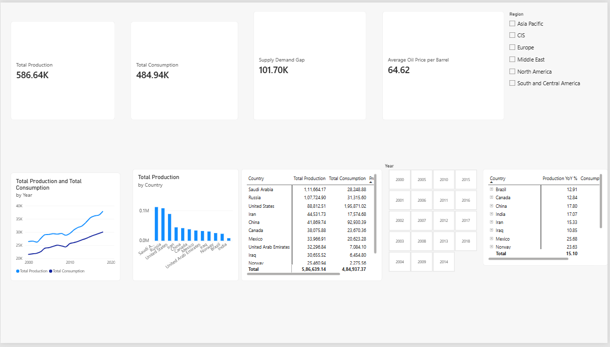
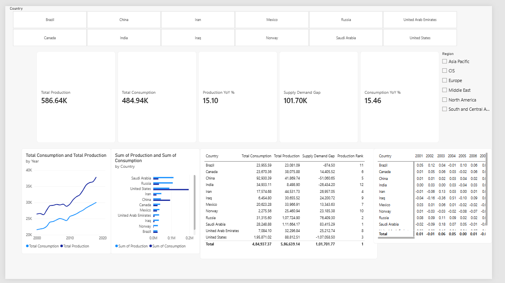
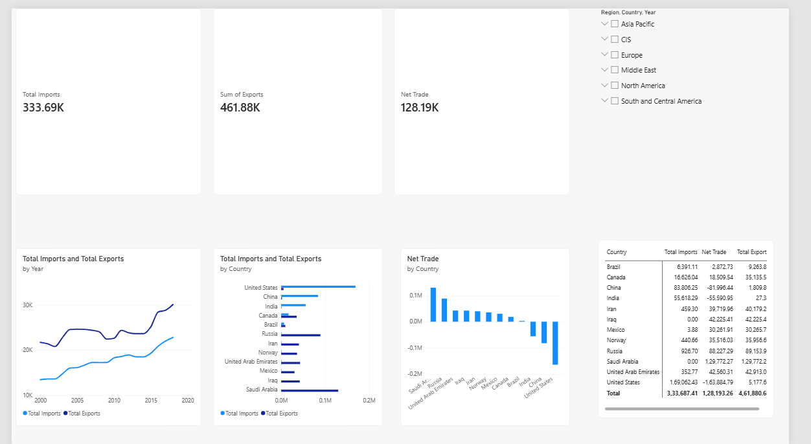
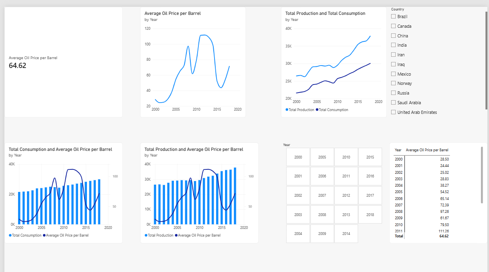

# Energy Market Intelligence Dashboard

A SQL and Power BI project exploring oil production, consumption, international trade, and crude oil price trends across 12 countries from **2000 to 2018**.

## Dashboard pages

1. **Global Overview** – high-level production, consumption, and price indicators.
2. **Country Comparison** – compare production and consumption across countries.
3. **Trade Analysis** – examine imports, exports, and net trade positions.
4. **Oil Price Trends** – explore crude oil price movements over time.

## Dashboard screenshots

**Global overview**

**Country comparison**

**Trade analysis**

**Oil price trends**

## Countries covered

Brazil, Canada, China, India, Iran, Iraq, Mexico, Norway, Russia, Saudi Arabia, the United Arab Emirates, and the United States.

## Tools used

- **MySQL 8+** – joins, aggregations, CTEs, and window functions.
- **Microsoft Power BI** – data modelling, DAX measures, and interactive dashboards.

## Repository structure

- `sql/schema.sql` – creates the database tables and key constraints
- `sql/energy_analysis.sql` – analytical SQL queries
- `powerbi/` – Power BI report
- `data/processed/` – six cleaned CSV tables
- `screenshots/` – dashboard screenshots
- `docs/` – data sources, preparation notes, data dictionary, and execution guide

## Data files and row counts

| File | Data rows | Description |
|---|---:|---|
| `Dim_Country.csv` | 12 | Country-to-region mapping |
| `Dim_Year.csv` | 19 | Years 2000–2018 |
| `Fact_Production.csv` | 228 | 12 countries × 19 years |
| `Fact_Consumption.csv` | 228 | 12 countries × 19 years |
| `Fact_Trade.csv` | 228 | 12 countries × 19 years |
| `Fact_oilsales.csv` | 19 | Annual crude oil prices |

The country-year fact tables are sorted by **Country, then Year**. The CSV files retain their full listed row counts, including zero values in trade data.

## Data and units

- Production and consumption are represented in **TWh**.
- Imports and exports are represented in **thousand barrels per day (kb/d)**. These are annual average rates; do not sum them across years and describe the result as cumulative physical volumes.
- Check the source unit for crude oil prices before conversion. The SQL price query divides by 6.2898 only when the stored values are in USD per cubic metre; do not convert values twice.

## Reproduce the analysis

Follow the complete [MySQL setup and execution guide](docs/sql-execution-guide.md):

1. Run [sql/schema.sql](sql/schema.sql) to create the database and tables.
2. Import the six CSV files from `data/processed/` using MySQL Workbench's Table Data Import Wizard. Import dimensions before facts.
3. Run [sql/energy_analysis.sql](sql/energy_analysis.sql) to execute the analysis queries.
4. Open [powerbi/Energy_analysis.pbix](powerbi/Energy_analysis.pbix), configure its data source if needed, and refresh.

The schema uses primary keys and foreign keys to enforce unique country-year records and valid dimension references.

## Data sources

See [docs/data-sources.md](docs/data-sources.md) for source links, and [docs/data-preparation.md](docs/data-preparation.md) for the preparation approach. The data dictionary is available at [docs/data-dictionary.md](docs/data-dictionary.md).

This is an exploratory historical analysis. Results depend on source coverage, country mappings, and data preparation choices.
